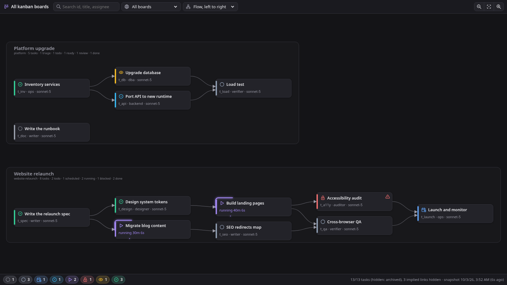
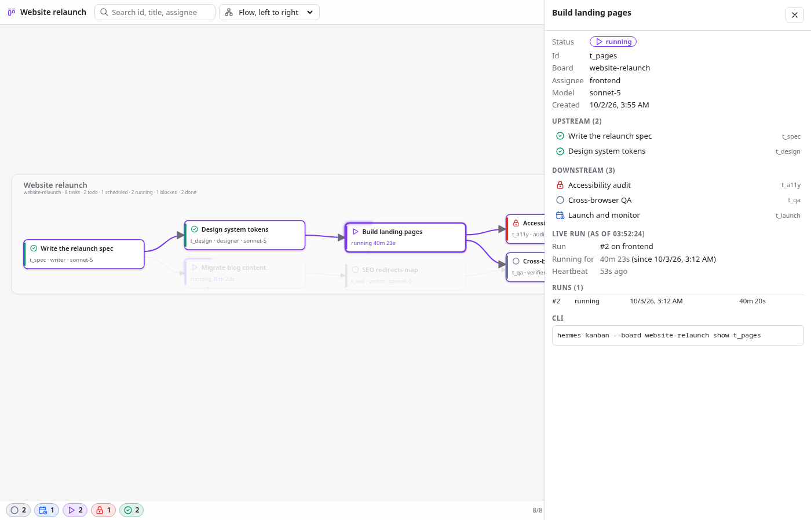

# Kanban Graph for Hermes

A live, read-only dependency graph of your [Hermes](https://github.com/NousResearch/hermes-agent)
kanban boards, inside Hermes Desktop. Every board is a band, every task a card, every dependency
an arrow. Click a task to light up everything it waits on and everything waiting on it, with its
runs, last failure and the running worker's latest tool calls in a side panel.



## Features

- **All boards in one view.** One band per board. Pan, zoom with the wheel, `0` fits.
- **Lineage selection.** Clicking a task selects its upstream and downstream; the rest fades.
- **Only the arrows you need.** An arrow A to C is not drawn when A already reaches C through
  B. The footer counts these as "implied hidden"; selecting a task still follows them.
- **Live.** One WebSocket tails every board's `task_events`; the graph re-lays out as work moves.
  A 15 s poll takes over when the socket is unavailable.
- **Running work stands out.** Running tasks show their duration and a highlight that travels
  their border, amber once the heartbeat goes quiet.
- **Deep links.** `hermes://open/kanban-graph?task=<board>/<id>` opens the page with that task
  selected.
- **Static snapshot.** `snapshot/kanban_graph.py` writes the same graph as one HTML file for CI or
  sharing, using only the Python standard library.
- **Read-only.** Board databases are opened with `mode=ro`. The plugin never writes a board.



## Requirements

- Hermes Agent 0.21.5 or newer, with Hermes Desktop for the live page.
- Nothing else: no API keys, no model calls, no Python or npm dependencies.

## Install

```sh
hermes plugins install Senci/hermes-kanban-graph --enable
```

Then, in Hermes Desktop, open **Capabilities > Plugins** and switch on **Kanban Graph**. The
desktop half of a plugin package is opt-in and starts switched off; until you switch it on, the
page does not exist.

Open the graph from the sidebar row **Kanban graph**, the command palette ("Open kanban graph"), or
a deep link. Step by step: [docs/tutorial/getting-started.md](docs/tutorial/getting-started.md).

## Documentation

| Kind | Read this when you want to |
|---|---|
| [Tutorial](docs/tutorial/getting-started.md) | install it and find your way around the page |
| [How-to guides](docs/how-to/) | open a task from a script, render a snapshot, update or remove it |
| [Reference](docs/reference/) | look up deep-link parameters, REST routes, keys, snapshot flags |
| [Explanation](docs/explanation/architecture.md) | understand how it is built and why |

## Development

```sh
git clone https://github.com/Senci/hermes-kanban-graph
cd hermes-kanban-graph
python3 -m unittest discover -s tests -v   # backend model and snapshot
node tests/layout.test.mjs                 # layout and transitive reduction
hermes plugins validate .                  # the plugin catalog's admission check
```

See [CONTRIBUTING.md](CONTRIBUTING.md) for the dev loop against a running Hermes Desktop.

## License

[MIT](LICENSE), Senad Ličina. Icons in `snapshot/tabler-icons.json` are
[Tabler Icons](https://tabler.io/icons), MIT.
