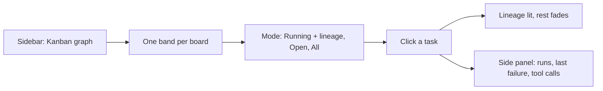
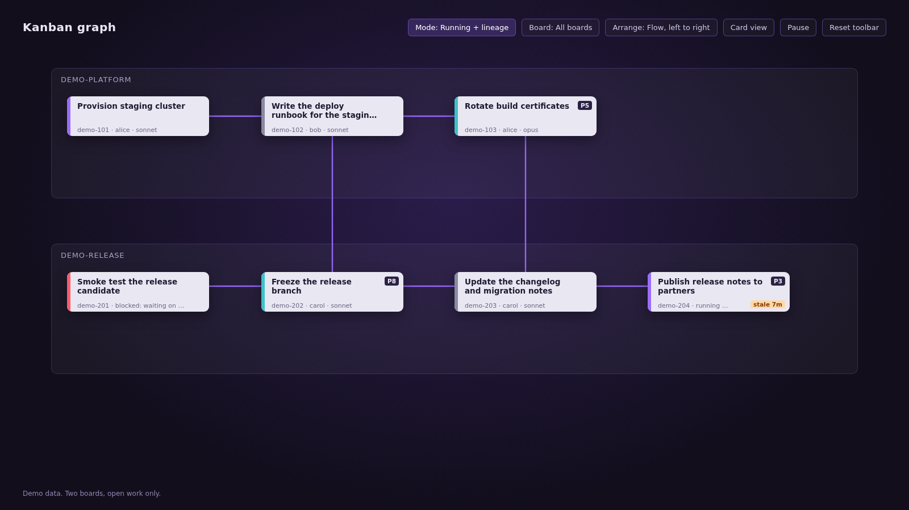

# Kanban Graph for Hermes

A live, read-only dependency graph of your [Hermes](https://github.com/NousResearch/hermes-agent)
kanban boards, inside Hermes Desktop.

## What it does

- Shows every board as a band, every task as a card, every dependency as an arrow.
- Click a task to light up what it waits on and what waits on it. A side panel shows its runs, last
  failure and the running worker's latest tool calls.
- Stays live and read-only: it never writes to a board.



## Install and enable

You need Hermes Agent 0.21.5 or newer and Hermes Desktop. No API keys, no other dependencies.

1. Install the plugin and enable its backend half:

   ```sh
   hermes plugins install Senci/hermes-kanban-graph --enable
   ```

2. Check that it is listed:

   ```sh
   hermes plugins list
   ```

3. Restart the Hermes backend, or the app, if it was already running. This mounts the routes the
   page reads from.
4. In Hermes Desktop, open **Capabilities > Plugins** and switch on **Kanban Graph**. The desktop
   half of a plugin starts switched off, and until you switch it on the page does not exist.
5. If the sidebar row does not appear within a few seconds, open the command palette (`Ctrl+K`, or
   `Cmd+K` on macOS) and run **Reload desktop plugins**.

## First use

1. Click **Kanban graph** in the sidebar. Or open the command palette and run **Open kanban
   graph**.

2. If nothing is running, the graph is empty. Switch the mode to **Open** to see queued work, or
   **All** to see everything.

3. Click a task card. The task and its lineage stay bright, the rest fades. The panel on the
   right shows the details.

4. Press `Esc` to clear the selection, `0` to fit the graph, `/` to search.

The next steps are in the [tutorial](docs/tutorial/getting-started.md). To write the graph to an
HTML file for CI (continuous integration) or sharing, see
[Render a static snapshot](docs/how-to/snapshot.md).



The image above is a static snapshot render, not the live page.

## Settings

The plugin has no configuration keys. The toolbar controls are remembered on this machine.

| Setting | Where | Default | What it changes |
|---|---|---|---|
| Mode | toolbar | **Running + lineage** | Which tasks show: running ones with their lineage, open ones, or all. |
| Board | toolbar, **Board** | **All boards** | Show one board or all of them. |
| Arrange | toolbar, **Arrange** | **Flow, left to right** | Layout: flow left to right, flow top down, columns by status, compact grid. |

The reset button (**Reset toolbar to defaults**) at the right end of the toolbar clears these remembered choices and returns to the defaults above.

## Troubleshooting

| Symptom | Cause | Fix |
|---|---|---|
| The page says "Kanban graph backend unreachable". | The Python half is not running. The plugin is not installed or enabled on that backend, or the backend was not restarted since. A remote gateway needs its own install. | Run the install again, restart the backend, then retry. To see this machine's boards, switch the window to **This device**. |
| The graph is empty in **Running + lineage**. | No task is running. | Switch the mode to **Open** or **All**. |
| A `hermes://open/kanban-graph` link shows only a loader. | The desktop half is switched off. | Switch on **Kanban Graph** in **Capabilities > Plugins**. |
| The sidebar row **Kanban graph** is missing. | The desktop half is off, or the app has not loaded it yet. | Switch it on, then run **Reload desktop plugins** from the command palette. |
| The status in the toolbar says "polling". | The live event socket is unavailable. | Nothing to do. The graph refreshes every 15 seconds. |

## More

- [Reference](docs/reference/README.md): deep-link parameters, REST routes, snapshot flags
- [How-to guides](docs/how-to/README.md)
- [How it is built](docs/explanation/architecture.md)
- [Development](CONTRIBUTING.md)
- [License](LICENSE) (MIT)
