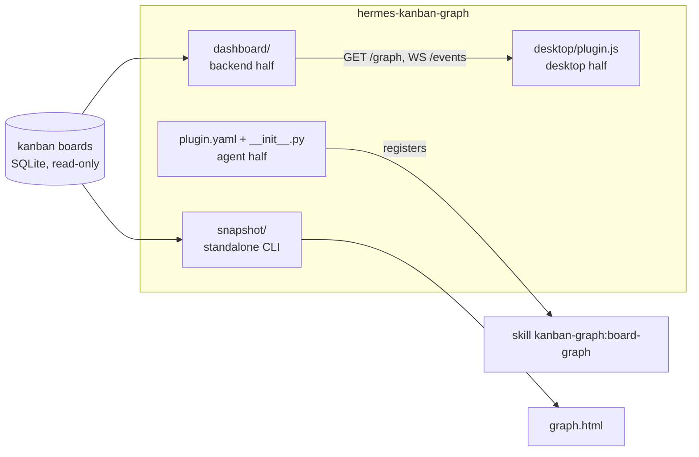
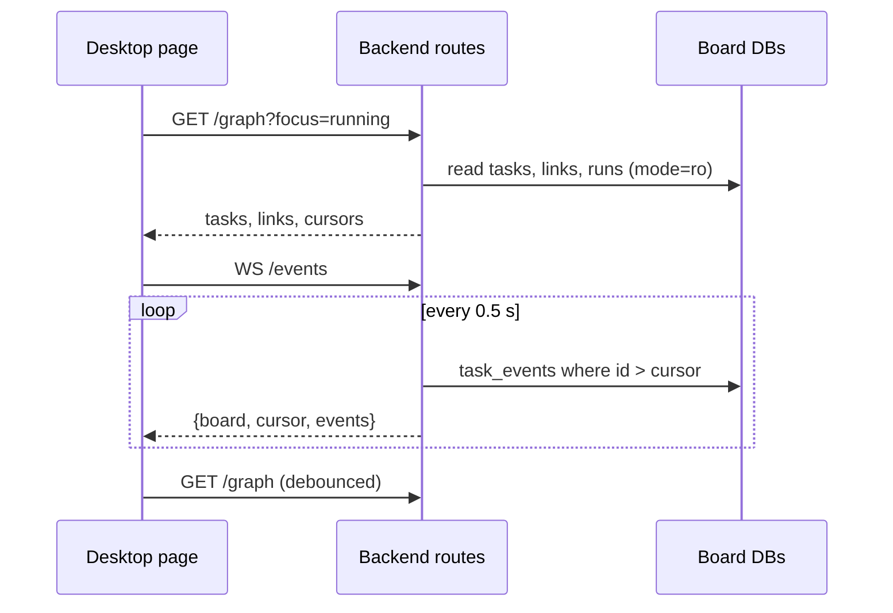

# How it works

## Three halves, one package

Hermes plugin packages can carry up to three halves, and this one uses all of them:

- The **agent half** is only there to register the bundled skill, so an agent knows the page, the
  deep link and the snapshot exist. It adds no tools: an agent that needs board data already has
  `hermes kanban`.
- The **backend half** mounts read-only routes on the local Hermes backend. It reads the board
  databases directly with `mode=ro` SQLite connections instead of going through the kanban engine,
  so it cannot take a write lock or change a board, and it keeps working across engine refactors
  as long as the schema holds.
- The **desktop half** is plain ESM using only `@hermes/plugin-sdk` and React, with no build step.
  Hermes Desktop loads it as a page plus a sidebar row and a palette entry.
- The **snapshot** reuses the backend's graph model and the desktop half's layout code, so the
  file and the page draw the same graph.

## Data flow

Events only say "something changed"; the page refetches the graph instead of patching it. A
graph of a few hundred tasks is small, and a full refetch can never drift from the database. When
the socket is not available (an OAuth remote gateway, an older Hermes) the page polls every 15 s
and says so in the toolbar.

The toolbar's indicator reads `live`, `polling` or `offline`. A failing graph fetch outranks the
socket and shows `offline`: the SDK binds a plugin socket to a backend once, at connect, while
REST calls follow the window's current gateway and profile, so a socket could be live on one
backend while the page reads another. The page reopens the socket whenever the window's
connection or profile changes, and keys its cached graph by both, so a switch never shows the
previous backend's data.

## Layout

The layout is a layered left-to-right (or top-down) flow per board, computed in the browser:

1. Filter to the visible tasks.
2. **Transitive reduction.** For every link A to C, look for another path from A to C through
   visible tasks. If one exists, the link carries no information the drawing does not already
   show, so it is not drawn and not used for layering. The footer counts these links as
   "implied hidden".
3. Assign layers by longest path from the roots, order each layer by the average position of its
   neighbours (barycenter) to reduce crossings, place the cards, then size each board's band to
   fit. Boards without links between them pack into a grid.
4. Route each drawn link as a curve. Where several links meet one card, their ends spread along
   the card's edge in the order of the other ends, so they stay apart.

Selection does not use the reduced set: clicking a task walks every link, hidden or not, so the
lineage is complete. Reduction only changes what is drawn.

The same layout code is pasted into the snapshot template at render time (between the
`// kg:layout-start` and `// kg:layout-end` markers in `desktop/plugin.js`), and the Node tests run it on recorded graphs to check
that no card leaves its band, nothing overlaps, and every hidden link is still implied by drawn
ones.

## Why read-only

The graph is an observer. Edits to tasks go through `hermes kanban` or the built-in kanban page,
which own validation, events and dispatcher wake-ups. A second writer would have to duplicate
all of that and could race the dispatcher. Keeping the plugin read-only also means a bug in it can
never damage a board.

## Why the desktop half is opt-in

Hermes Desktop starts every plugin package's desktop half switched off, separate from the agent
and backend switches, because a desktop plugin runs with the renderer's full authority. The page
appears only after Capabilities > Plugins > Kanban Graph is switched on.
