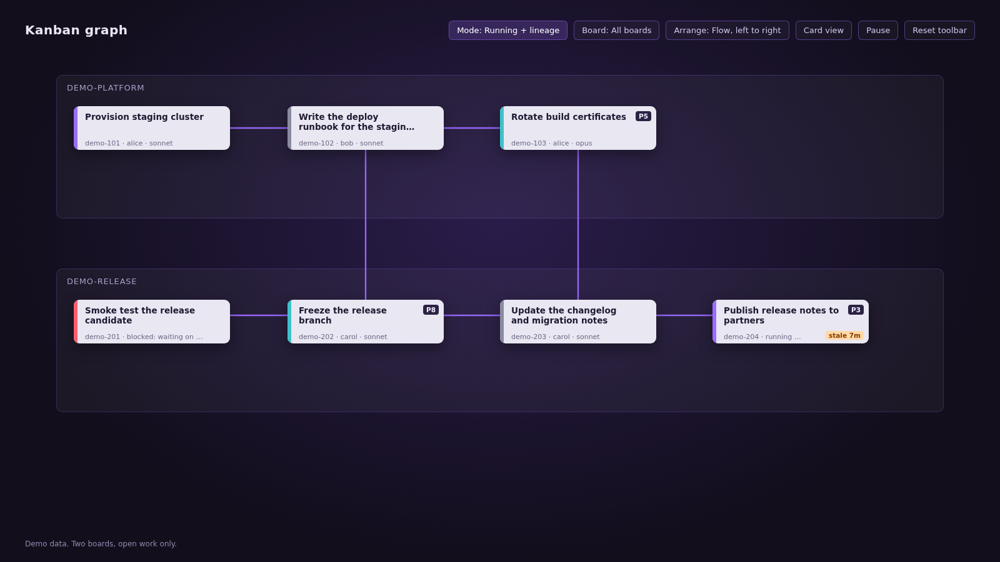

# Render a static snapshot

`snapshot/kanban_graph.py` writes the graph as one self-contained HTML file. It has the same
layout, lineage selection and detail panel as the page, but no live updates. Use it without Hermes
Desktop: in CI (continuous integration), on a remote gateway, or to share a board's state.

You need Python 3.11 or newer. The script reads the boards read-only. Install the plugin first, see
[Install and enable](../../README.md#install-and-enable).

```sh
cd ~/.hermes/plugins/kanban-graph
python3 snapshot/kanban_graph.py --board <slug> --hide-status done
```

The script prints the output path and counts:

```
/home/you/.hermes/cache/kanban-graph/website-relaunch.html  boards=1 tasks=6 links=8
```

Open the file in any browser. This is what you get:



## Common variants

| Goal | Flags |
|---|---|
| Every board | (no `--board`) |
| Several boards | `--board a --board b` |
| Only open work | `--hide-status done` |
| Running tasks and their lineage | `--focus-status running` |
| Include archived tasks or boards | `--archived`, `--archived-boards` |
| Choose the file | `--out path/to/graph.html` |
| List board slugs | `--list` |

All flags: [reference/snapshot-cli.md](../reference/snapshot-cli.md).

## Another Hermes home

The script reads boards from `$HERMES_HOME/kanban/boards/` (default `~/.hermes`):

```sh
HERMES_HOME=/srv/hermes python3 snapshot/kanban_graph.py
```

## Sharing

The file embeds task titles, bodies, results and errors. Share it only with people who may read
the boards.
